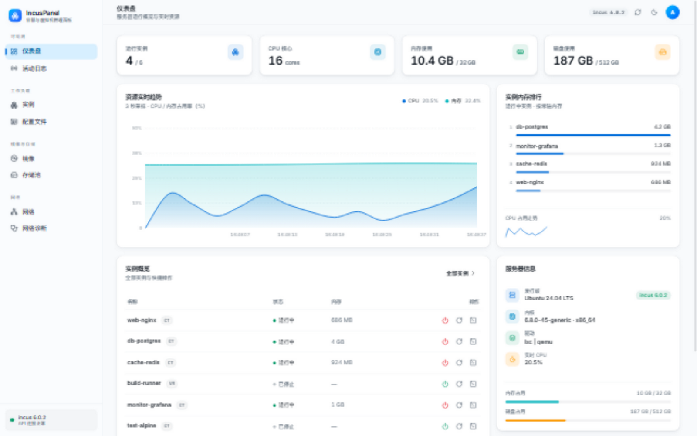
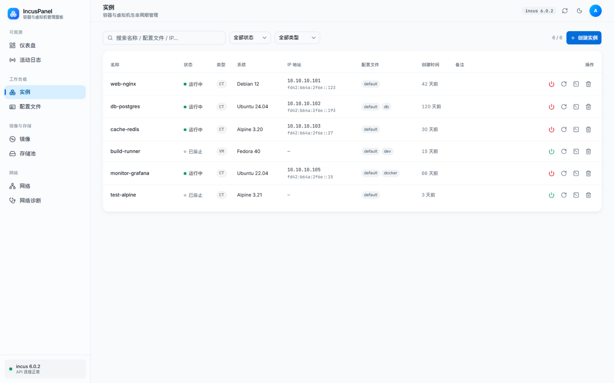
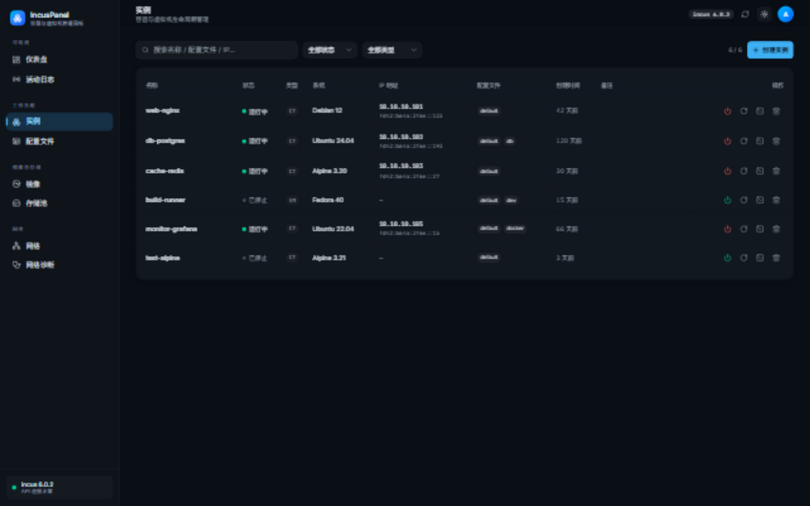

<div align="center">

# IncusPanel

**[Incus](https://linuxcontainers.org/incus/) 的轻量 Web 管理面板 —— 单个二进制文件，内嵌全部前端资源，零外部依赖，开箱即用**

[](https://github.com/jiqing112/incus-web/releases/latest)
[](LICENSE)


[下载安装](#-部署) · [功能总览](#-功能) · [问题反馈](https://github.com/jiqing112/incus-web/issues)



</div>

---

IncusPanel 面向自建 Incus 宿主机的个人与团队：把 `incus` CLI 的高频操作（实例生命周期、快照备份、镜像、网络、存储）搬进浏览器。后端 Go + Gin 直连本机 Incus unix socket，前端 Svelte 5 + Tailwind 4 构建产物经 `go:embed` 打进同一个可执行文件 —— **部署 = 放一个文件 + 跑起来**。UI 提供「浅色呼吸感 SaaS / 深色控制台」双主题（Inter + JetBrains Mono、oklch 色板、等宽数字）。

| 仪表盘 | 实例管理 | 深色主题 |
| --- | --- | --- |
|  |  |  |

## ✨ 功能

| 模块 | 能力 |
| --- | --- |
| 仪表盘 | 服务器概览、CPU/内存占用实时趋势（3s 采样）、实例内存排行、SSE 实时活动流 |
| 实例 | 列表（名称/状态/类型/**系统名**/**IP 地址**/配置文件/创建时间/备注）、搜索/过滤、创建（**引用本地镜像** 或远程镜像拉取，可选存储池/网桥）、启动/停止/重启、删除（运行中自动先停后删） |
| 实例详情 | 概览（资源仪表、网络地址与流量计数、配置与设备）· 快照（创建/恢复/重命名/删除 + 自动过期 + 自动快照计划）· 备份（创建/下载/删除/发布为镜像）· 文件（浏览/上传/下载/删除）· 终端（xterm.js 全功能交互） |
| 镜像 | 卡片视图、远程列表刷新、simplestreams 导入、导出、删除、**远程镜像搜索（磁盘缓存 + 后台定期刷新）** |
| 网络 | 网桥列表、创建/编辑/删除、DHCP 租约、配置与引用详情 |
| 存储池 | 池与卷管理、驱动徽标、创建/删除 |
| 配置文件 | 卡片视图、新建/编辑（配置项 + 设备 KV 编辑器）、删除保护 |
| 网络诊断 | 一键体检 IPv4 转发 / nftables 转发放行 / MASQUERADE / Docker 冲突，并提供修复 |
| 安装向导 | 宿主机未装 Incus 时，面板内直接安装（Debian/Ubuntu 与 RHEL/CentOS 系，支持 zfs/btrfs/dir 后端） |
| 活动日志 | SSE 事件流、类型过滤、暂停/清空 |

## 🚀 部署

> 面板通过本机 unix socket 直连 Incus，因此**必须运行在 Incus 宿主机上**（Linux）。所有历史版本与校验文件见 [Releases](https://github.com/jiqing112/incus-web/releases)。

### 方式一：一键安装（Linux + systemd，推荐）

```bash
curl -fsSL https://raw.githubusercontent.com/jiqing112/incus-web/main/scripts/install.sh | sudo bash
```

脚本会自动完成：检测架构（amd64/arm64）→ 下载 [最新 Release](https://github.com/jiqing112/incus-web/releases/latest) → 安装到 `/usr/local/bin/incus-web` → 生成随机 `API_TOKEN` 并写入 `/etc/default/incus-web` → 注册 systemd 服务并开机自启。安装结束会把面板地址和 Token 打印在终端上。

也可以自定义版本 / 端口 / Token：

```bash
# 指定版本
curl -fsSL https://raw.githubusercontent.com/jiqing112/incus-web/main/scripts/install.sh | sudo bash -s -- v0.1.0
# 指定端口与 Token（环境变量方式）
sudo PORT=9090 API_TOKEN=my-secret bash install.sh
```

### 方式二：手动下载二进制

到 [**Releases 页面**](https://github.com/jiqing112/incus-web/releases/latest) 下载对应平台的压缩包，或直接用命令行取最新版（Linux x86_64 示例）：

```bash
# 取最新 tag（如 v0.1.0）
VER=$(curl -fsSL -o /dev/null -w '%{url_effective}' https://github.com/jiqing112/incus-web/releases/latest | sed 's#.*/tag/##')

# 下载并解压
curl -fLO "https://github.com/jiqing112/incus-web/releases/download/${VER}/incus-web-${VER}-linux-amd64.tar.gz"
tar -xzf "incus-web-${VER}-linux-amd64.tar.gz"
sudo install -m 0755 "incus-web-${VER}-linux-amd64" /usr/local/bin/incus-web

# 运行（需 root 以访问 Incus unix socket）
sudo API_TOKEN=改成你的随机令牌 PORT=8080 incus-web
```

每个 Release 均附带 `incus-web-<版本>-checksums.txt`（SHA256），可用 `sha256sum -c` 校验完整性。

| 平台 | Release 资产 | 用途 |
| --- | --- | --- |
| Linux x86_64 | `incus-web-<版本>-linux-amd64.tar.gz` | 生产部署（Incus 宿主机） |
| Linux arm64 | `incus-web-<版本>-linux-arm64.tar.gz` | 树莓派 / Ampere / Graviton 宿主机 |
| Windows x86_64 | `incus-web-<版本>-windows-amd64.zip` | 开发调试（配合前端 mock 模式预览 UI） |

### systemd 常驻（手动部署时）

```ini
# /etc/systemd/system/incus-web.service
[Unit]
Description=IncusPanel - Incus web panel
After=network-online.target incus.service
Wants=network-online.target

[Service]
Type=simple
ExecStart=/usr/local/bin/incus-web
EnvironmentFile=/etc/default/incus-web
Restart=on-failure
RestartSec=3

[Install]
WantedBy=multi-user.target
```

```bash
# /etc/default/incus-web
PORT=8080
API_TOKEN=换成一段随机字符串
# BIND_ADDR=127.0.0.1        # 只允许本机 / 反向代理访问
# INCUS_SOCKET=/var/lib/incus/unix.socket
```

```bash
sudo systemctl daemon-reload && sudo systemctl enable --now incus-web
```

### 登录与初始化

1. 浏览器打开 `http://<宿主机IP>:8080`；
2. 输入 `API_TOKEN` 登录（未设置该环境变量时，面板会在启动日志里打印随机生成的令牌）；
3. 宿主机尚未安装 Incus 时，会自动进入**安装向导**，按引导选择存储后端（zfs / btrfs / dir）完成安装。

### 环境变量

| 变量 | 默认值 | 说明 |
| --- | --- | --- |
| `PORT` | `8080` | HTTP 监听端口 |
| `BIND_ADDR` | `0.0.0.0` | HTTP 监听地址；只想本机访问可设为 `127.0.0.1` |
| `INCUS_SOCKET` | 自动探测 | Incus unix socket 路径。未设置时依次探测 `/var/lib/incus/unix.socket`（Debian/Ubuntu/Arch/源码）与 `/run/incus/unix.socket`（Fedora/RHEL/Rocky），并在 socket 晚于面板出现时自动重连 |
| `API_TOKEN` | 未设置时随机生成 | 登录 Token（Bearer 认证）。未显式设置时启动会生成随机令牌并打印到日志，重启后变化，**生产环境务必固定** |
| `DATA_DIR` | 可执行文件同级 `data/` | 持久化数据目录（远程镜像索引缓存等） |
| `REMOTE_IMAGE_REFRESH_MINUTES` | `30` | 后台刷新远程镜像索引的间隔（分钟） |

## 🔨 从源码构建

依赖：Go 1.22+、Node.js 20.19+（含 npm）。

```bash
git clone https://github.com/jiqing112/incus-web.git
cd incus-web

# Windows：一键构建（前端 vite build → 同步 handler/dist → 交叉编译 win/linux）
./build.ps1

# Linux / macOS 手动构建
(cd frontend && npm ci && npm run build)
rm -rf handler/dist && mkdir -p handler/dist && cp -r frontend/dist/. handler/dist/
CGO_ENABLED=0 go build -ldflags "-s -w -X main.Version=dev" -o incus-web .
```

### 前端开发模式（无需 Incus）

内置完整的内存 mock 后端（6 个仿真实例、镜像/存储/网络、实时资源曲线）：

```bash
cd frontend
npm install
VITE_MOCK=1 npx vite        # http://localhost:5173，任意 Token 可登录
```

## 🏷️ 版本发布（GitHub Actions）

仓库内置 [release 工作流](.github/workflows/release.yml)：**推送 `v*` 标签即自动构建**三平台二进制并发布到 [Releases](https://github.com/jiqing112/incus-web/releases)，同时附 SHA256 校验文件：

```bash
git tag v0.1.0
git push origin v0.1.0
```

工作流每次构建都会：`npm ci && npm run build` 打包前端 → 同步进 `handler/dist` → `go build` 交叉编译 → 打包 tar.gz / zip → 创建 Release 并写入 Release Notes。版本号通过 `-ldflags "-X main.Version=<tag>"` 注入，面板侧栏与日志中可见。

## 🏗️ 架构

```
frontend/                 Svelte 5 + Tailwind 4 + shadcn-svelte(nova) 前端
  src/lib/api.ts          类型化 API 客户端（Bearer 认证、401 处理、SSE 订阅）
  src/lib/mock.ts         开发/演示用内存 Incus 世界（VITE_MOCK=1 启用）
  src/lib/pages/          页面（仪表盘/实例/详情五标签/镜像/网络/存储/配置/事件）
  src/lib/components/     设计系统组件（ui/ charts/ common/ layout/）
handler/                  Gin HTTP 层（含 go:embed 的 dist SPA 服务）
incus/                    Incus REST / exec / files 客户端（unix socket 直连）
model/ types.go           与前端 types.ts 对齐的数据模型
event/                    SSE 事件分发 broker
scripts/install.sh        一键安装脚本（下载 Release + systemd）
.github/workflows/        CI：tag 触发的多平台构建与发布
```

### 实现说明（踩坑记录）

<details>
<summary><strong>点开查看</strong>（与 Incus API 打交道的原始笔记，或许能帮你少踩坑）</summary>

- **exec 终端**：Incus exec websocket 只消费 **binary 帧**，text 帧会被服务端静默丢弃；输入统一以 BinaryMessage 转发。
- **文件列表**：Incus 目录列表的响应头仅描述被列目录本身，每个条目的 type/mode/uid/gid 需要逐个 `GET files?path=` 读响应头，后端已做并发 stat。
- **服务器资源**：`/1.0/resources` 的 CPU 总核数字段是 `cpu.total`；磁盘占用取自宿主机根文件系统 `statfs("/")`，CPU 使用率由 `/proc/stat` 累计 busy ns 差分得出（仅 Linux）。
- **实例列表的 IP 与系统名**：`GET /1.0/instances?recursion=2` 的每个条目**本来就带 `state`**（含网络地址），但需要显式在结构体里声明 `state` 字段才能取到，否则会被静默丢弃导致列表 IP 一直为空。系统名取自实例 config 的 `image.os` / `image.release`（镜像元数据里大小写不统一，展示时统一首字母大写）。
- **删除运行中实例**：Incus 的 `DELETE /1.0/instances/{name}?force=true` 对运行中实例**仍然返回 400 "Instance is running"**（与 CLI `--force` 行为不同），因此面板改为先 stop 再 delete。
- **引用本地镜像建实例**：Incus 的 `source` 必须省略 `server`/`protocol` 才会在本地镜像库解析，否则会被当作远程源；本地镜像用 `fingerprint` 引用最稳妥。
- **远程镜像索引缓存**：`incus image list <remote>:` 拉一次约 7–15s，故结果按远程源落盘到 `DATA_DIR/remote-image-cache.json`，读接口缓存优先（命中约 20ms），软过期（10min）时返回旧数据并触发后台异步刷新，另有后台 goroutine 按 `REMOTE_IMAGE_REFRESH_MINUTES` 全量刷新。
- **快照重命名**：走 `POST /1.0/instances/{name}/snapshots/{snap}` 携带 `{"name": "新名"}`，不是 PATCH。
- **stateful（运行时）快照**：**普通快照无需关机**，运行中可直接打。只有 `stateful=true` 才需要保存内存状态：**虚拟机**由 QEMU 原生支持（无需 CRIU）；**容器**依赖宿主机安装 CRIU，且官方文档明确说明该特性对容器「not fully supported」。宿主机缺 CRIU 时 Incus **不会快速报错而是长时间挂起**，故新增 `GET /api/server/features`（`{criu, container_stateful, vm_stateful}`）供前端提前探测并禁用该选项。
- **容器 stateful 快照实测结论**（Debian 13 / 内核 6.12.57 / Incus 6.0.4 / CRIU 4.1.1，`apt install criu` 后 `container_stateful` 探测翻转为 true）：
  1. 装上 CRIU 后不再挂起，改为快速报错，**首个门槛是实例配置**：`Stateful snapshots require that the instance has migration.stateful be set to true` —— 必须 `incus config set <name> migration.stateful true`（面板目前不暴露该开关）。
  2. 开启后 CRIU 真正被调用，但**带网卡的 alpine 容器 dump 失败**：`criu/sk-netlink.c: netlink: The socket has data to read`（容器网络命名空间的 netlink socket 有未读数据）。
  3. **debian 容器无论有无网卡都失败**：`criu/namespaces.c: Can't dump nested uts namespace`（systemd 派生了嵌套 UTS namespace，CRIU 无法处理）。
  4. **唯一「能创建成功」的组合**是无网卡的 alpine 容器：`incus snapshot create <name> <snap> --stateful` 返回 Success、快照 `stateful=YES`；但**恢复仍然失败** —— `forkmigrate ... exit status 1`，incusd 日志只有 `Error collecting checkpoint log file: lstat .../state/restore.log: no such file or directory`（CRIU restore 未产出日志）。先 `incus stop` 再 restore 也一样失败；`incus start --stateful` 这个选项并不存在。
  5. **测试注意**：容器内用 `incus exec` 起的后台进程，其 session leader 落在宿主机 pid namespace，会让 CRIU 报 `A session leader of ... is outside of its pid namespace`；须用 `setsid` 启动才能通过这一关（这也说明容器 stateful 对「有 exec 会话」的场景天然不友好）。
  6. **结论**：当前 CRIU 版本下，**容器 stateful 快照实际不可用**，只有 VM 的 stateful 快照可靠。面板 UI 据此对容器默认禁用 stateful 选项是正确策略。
  7. **`incus init` 在该宿主机上会卡死**（实测 >477s 未返回），而走面板 API（`POST /1.0/instances`）创建只要几秒 —— 脚本化测试一律走 API。
- **单二进制交付**：前端构建产物经 `go:embed all:dist` 打包，SPA 未命中路径回退 `index.html`（hash 路由）。
- **安装向导实测（Debian 13 + CentOS Stream 9）**：
  1. **socket 路径**：RHEL 系包安装的 socket 在 `/run/incus/unix.socket`，写死 `/var/lib/incus/unix.socket` 会让面板除安装页外全部 500。已改为自动探测 + 延迟重解析，安装状态接口返回 `socket_path` / `api_reachable` 供前端提示。
  2. **idmap 是容器硬前提**：`/etc/subuid`、`/etc/subgid` 缺 root 条目时，incusd 报 `System doesn't have a functional idmap setup`，容器一个都起不来，而安装脚本照样报成功。包安装不会写这两行，现在所有安装方式统一补 `root:1000000:1000000000`。
  3. **profile 磁盘设备必须带 `path=/`**：只写 `pool=` 会被拒（`Disk entry is missing the required "source" or "path" property`），默认 profile 没有 root 磁盘 → 新建实例全部失败。
  4. **`incus storage list | grep -q .` 恒为真**（表格有表头），原判断导致 `admin init` 永远不执行；改用 `--format csv` 判断，并且不再在按所选后端建池之前 `admin init`（它会抢先建 dir 池，把 btrfs/zfs 顶掉）。
  5. **RHEL 系 EPEL**：`incus` 不在 EPEL 9，需 COPR `neelc/incus`；`epel-release` 已装但被禁用时，install 是空操作，必须显式 `--enablerepo=epel` 才能解析 `lxc` 依赖。
  6. **btrfs 在内核不支持时**（RHEL/CentOS 无 btrfs 模块）提前降级为 dir，不再空转 5 轮 API 重试。
  7. **验证容器优先用本地镜像**：`incus launch images:alpine/3.21` 强制走远程，受限网络下实测 3.7 kB/s，300s 超时后 CLI 被杀但服务端仍在建实例（孤儿实例 + 未结束操作）。现改为本地别名优先、必要时限时 `image copy` 后从本地启动。
  8. **`install_fs_tools` 只装所选后端**：原实现无论选什么都 `apt install zfsutils-linux`，给纯 btrfs 用户塞进一整套 ZFS 用户态与 `zfs-zed` 守护进程。
  9. **安装脚本 45 分钟硬超时**：`apt/dnf` 等锁可能无限挂起，一旦挂住 `installRunning` 永不复位，后续安装请求全部 409（只能重启面板）。超时按进程组强杀并补写 `[DONE] rc=124`。

</details>

## ⚠️ 安全提示

面板持有 Incus 完整控制权（等于宿主机 root），务必：

- 固定一个随机的 `API_TOKEN`（未设置时面板会生成随机令牌并打印到启动日志，但重启即失效）；
- 仅监听内网，或 `BIND_ADDR=127.0.0.1` 配合 Nginx/Caddy 反向代理 + TLS 后再对外；
- 不要将面板端口直接暴露公网。

面板自身已做的防护：

- 不存在公开的默认 Token，未配置时一律随机生成；
- 访问日志只记录请求路径、不记录 query（终端 / 下载 / SSE 的 token 都在 `?token=` 中，避免令牌落盘）；
- 安装脚本与日志写入 `<tmp>/incus-web-install/`（目录 0700），日志读取接口只允许该目录下的 `install.log`。

## 🤝 参与

Issue / PR 均欢迎。前端开发可直接用 mock 模式起跑（无需 Incus 环境），后端改动请保证 `go vet ./...` 与 `npm run check` 通过。

## 📄 License

[MIT](LICENSE) © 2026 jiqing112
